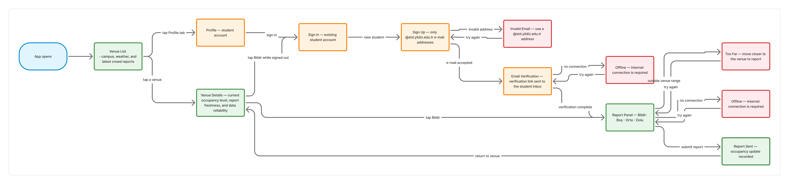
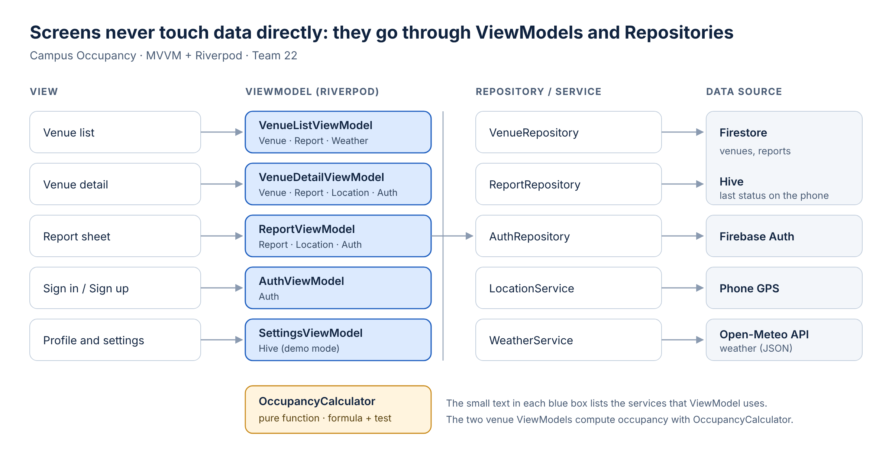

# 4. Architecture

The app consists of 7 screens, 2 Firestore collections and MVVM layers; state is managed with Riverpod.

## 4.1 Screen map

The app opens directly on the venue list, because viewing needs no sign-in. The sign-in screen is reached only when the user wants to report, or from the profile. Mockup: [Figma](https://www.figma.com/design/IMpJjh3kscYoXShQRoBfCW) · 12 screens in `docs/` (`mockup_1_venue_list.png` … `mockup_12_report_sent.png`). Screens 9–12 show the rules in action: offline mode, a closed venue, the distance check and the 15-minute limit after a report.

## 4.2 Data model

**Venue** (Firestore `venues`, 8 records)

| Field | Type | Example | Used for |
| --- | --- | --- | --- |
| name | string | "Hokka Cafe" | Card title |
| type | string | cafe / dining / gym | Filters |
| group | string (optional) | "dining" | Showing both dining hall floors on one card |
| photoUrl | string | image URL | Card image |
| lat, lng | number | 41.027, 28.889 | GPS check |
| radiusM | number (m) | 120 | GPS check |
| halfLifeMin | number (min) | 10 | Occupancy calculation |
| hasOutdoor | boolean | true | Weather warning |
| openingHours | list of time ranges | [11:30–14:30, 17:00–19:15] | "Closed" status |

**Report** (Firestore `reports`, one record per report)

| Field | Type | Example |
| --- | --- | --- |
| venueId | string | "hokka" |
| userId | string | Firebase Auth user id |
| level | number | 0 (empty) / 50 (moderate) / 100 (full) |
| createdAt | timestamp | 10.11.2026 12:31 |

**User:** No separate collection. Name, email and verification status are kept by Firebase Auth (name as the display name); the 15-minute rule is checked against the `reports` collection.
**On the phone (Hive):** Each venue's last calculated status and when it was calculated. This is shown when offline.

### How occupancy is calculated

A venue's status is not stored; it is calculated from recent reports every time. This way an old "full" never gets stuck on the screen.

1. Each report gets a weight based on its age: `weight = 0.5 ^ (minutes since report / half-life)`. The half-life is 7 minutes for the dining hall, 10 for cafés and 20 for the gym. Reports older than about 4.5 half-lives are ignored (30 / 45 / 90 min).
2. The occupancy percentage is the weighted average: `Σ(weight × level) / Σ(weight)`.
3. Label: 0–35% Empty, 35–65% Moderate, 65–100% Full. The percentage is shown only on the detail screen.
4. If the weights add up to less than 1.5 the card says "low confidence"; with no reports it says "no data". Outside opening hours it says "Closed".

**Example:** Three people reported "empty" 25 minutes ago and one reported "full" 2 minutes ago (café, half-life 10 min). The weights are 3 × 0.177 and 0.871; occupancy = 87.1 / 1.401 = **62% → Moderate**, with low confidence because the weights sum to 1.40. A plain average would give 25% (Empty) and miss the most recent "full" report.

## 4.3 MVVM diagram

| Layer | Role | In this app |
| --- | --- | --- |
| View | Only draws and passes user actions to the ViewModel | Venue list, Venue detail, Report sheet, Sign in / Sign up, Profile |
| ViewModel | Makes decisions and holds the screen's state | VenueListViewModel, VenueDetailViewModel, ReportViewModel, AuthViewModel, SettingsViewModel |
| Repository / Service | Knows where the data comes from | VenueRepository, ReportRepository, AuthRepository, LocationService, WeatherService |
| Data source | The data itself | Firestore, Firebase Auth, Hive, GPS, Open-Meteo |

The occupancy formula lives in a pure function (`OccupancyCalculator`) outside the layers, so the example above can become an automated unit test.

**The path of a report:** The user taps "Full" → ReportViewModel checks email verification, distance, opening hours and the 15-minute rule → ReportRepository writes the record to Firestore → Firestore delivers the new report to every phone → VenueListViewModel on each phone recalculates occupancy → the cards update.

## 4.4 Why Riverpod

We chose Riverpod over Provider:

1. **It connects directly to live data:** `StreamProvider` binds the Firestore report stream to the screen in a single line. This live stream is the core of the app.
2. **ViewModels can use each other easily:** The venue detail ViewModel needs both the location service and the sign-in state. In Riverpod this needs no `BuildContext`.
3. **Errors are caught early:** Provider's "ProviderNotFound" error appears only at runtime; Riverpod catches similar mistakes at compile time.
