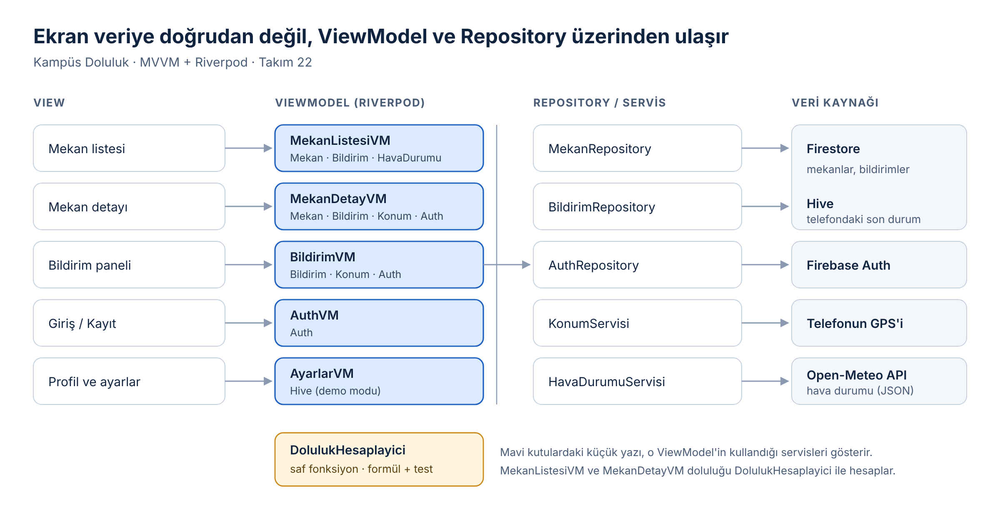

# 4. Mimari

Uygulama 5 ekran, 2 Firestore koleksiyonu ve MVVM katmanlarından oluşuyor; durum yönetimi için Riverpod kullanılıyor.

## 4.1 Ekran haritası

Uygulama doğrudan mekan listesiyle açılır, çünkü bakmak için giriş gerekmez. Giriş ekranına yalnızca bildirim yapılmak istendiğinde ya da profilden gidilir. Mockup: [Figma](https://www.figma.com/design/IMpJjh3kscYoXShQRoBfCW/Kamp%C3%BCs-Doluluk-%E2%80%93-Mockup?node-id=2-58&t=8djlida3WnoATH6q-0) · [docs/mockup.png](mockup.png)

## 4.2 Veri modeli

**Mekan** (Firestore `mekanlar`, 8 kayıt)

| Alan | Tür | Örnek | Ne için |
| --- | --- | --- | --- |
| ad | metin | "Hokka Cafe" | Kart başlığı |
| tur | metin | kafe / yemekhane / spor | Filtreler |
| grup | metin (boş olabilir) | "yemekhane" | Alt ve üst katı tek kartta birleştirmek |
| fotograf | metin | resim adresi | Kart görseli |
| enlem, boylam | sayı | 41.027, 28.889 | GPS kontrolü |
| yaricap | sayı (m) | 120 | GPS kontrolü |
| yariOmur | sayı (dk) | 10 | Doluluk hesabı |
| acikAlan | evet/hayır | true | Hava durumu uyarısı |

**Bildirim** (Firestore `bildirimler`, her bildirimde bir kayıt)

| Alan | Tür | Örnek |
| --- | --- | --- |
| mekanId | metin | "hokka" |
| kullaniciId | metin | Firebase Auth kimliği |
| seviye | sayı | 0 (boş) / 50 (orta) / 100 (dolu) |
| zaman | tarih | 10.11.2026 12:31 |

**Kullanıcı:** Ayrı bir koleksiyon yok. E-posta ve doğrulama bilgisi Firebase Auth'ta tutuluyor; 15 dakika kuralı `bildirimler` koleksiyonundan kontrol ediliyor.

**Telefonda (Hive):** Her mekanın son hesaplanan durumu ve hesaplanma zamanı. İnternet yokken bu gösterilir.

### Doluluk nasıl hesaplanıyor

Mekanın durumu veritabanında saklanmaz; her seferinde son bildirimlerden hesaplanır. Böylece eski bir "dolu" bilgisi ekranda takılı kalmaz.

1. Her bildirime zamana göre ağırlık verilir: `ağırlık = 0,5 ^ (geçen dakika / yarı ömür)`. Yarı ömür yemekhanede 7, kafelerde 10, spor salonunda 20 dakikadır. Yarı ömrün yaklaşık 4,5 katından eski bildirimler hesaba katılmaz (30 / 45 / 90 dk).
2. Doluluk yüzdesi ağırlıklı ortalamadır: `Σ(ağırlık × seviye) / Σ(ağırlık)`.
3. Etiket: %0–35 Boş, %35–65 Orta, %65–100 Dolu. Yüzde yalnızca detay ekranında gösterilir.
4. Ağırlıkların toplamı 1,5'ten küçükse "güven düşük", hiç bildirim yoksa "veri yok" yazılır.

**Örnek:** 25 dakika önce 3 kişi "boş", 2 dakika önce 1 kişi "dolu" demiş (kafe, yarı ömür 10 dk). Ağırlıklar 3 × 0,177 ve 0,871; doluluk = 87,1 / 1,401 = **%62 → Orta**, ağırlık toplamı 1,40 olduğu için güven düşük. Düz ortalama %25 (Boş) verirdi ve son gelen "dolu" bilgisini kaçırırdı.

## 4.3 MVVM diyagramı

| Katman | Görevi | Bu uygulamada |
| --- | --- | --- |
| View | Yalnızca çizer, kullanıcı hareketini ViewModel'e iletir | Mekan listesi, Mekan detayı, Bildirim paneli, Giriş/Kayıt, Profil |
| ViewModel | Karar verir, ekranın durumunu tutar | MekanListesiVM, MekanDetayVM, BildirimVM, AuthVM, AyarlarVM |
| Repository / Servis | Verinin nereden geldiğini bilir | MekanRepository, BildirimRepository, AuthRepository, KonumServisi, HavaDurumuServisi |
| Veri kaynağı | Verinin kendisi | Firestore, Firebase Auth, Hive, GPS, Open-Meteo |

Doluluk formülü, katmanlardan bağımsız saf bir fonksiyonda (`DolulukHesaplayici`) duruyor. Böylece yukarıdaki örnek otomatik bir teste dönüştürülebiliyor.

**Bir bildirimin yolu:** Kullanıcı "Dolu"ya basar → BildirimVM e-posta doğrulamasını, mesafeyi ve 15 dakika kuralını kontrol eder → BildirimRepository kaydı Firestore'a yazar → Firestore yeni bildirimi tüm telefonlara iletir → her telefondaki MekanListesiVM doluluğu yeniden hesaplar → kartlar güncellenir.

## 4.4 Neden Riverpod

Provider yerine Riverpod'u seçtik:

1. **Canlı veriye doğrudan bağlanıyor:** `StreamProvider`, Firestore'daki bildirim akışını ekrana tek satırla bağlıyor. Uygulamanın temeli bu canlı akış.
2. **ViewModel'ler birbirini kolayca kullanıyor:** Mekan detayı ViewModel'i hem konum servisine hem giriş durumuna ihtiyaç duyuyor. Riverpod'da bunlara erişmek için ekranın `BuildContext`'ine gerek yok.
3. **Hatalar erken yakalanıyor:** Provider'daki "ProviderNotFound" hatası uygulama çalışırken ortaya çıkar; Riverpod'da benzer hatalar derleme sırasında görülür.
